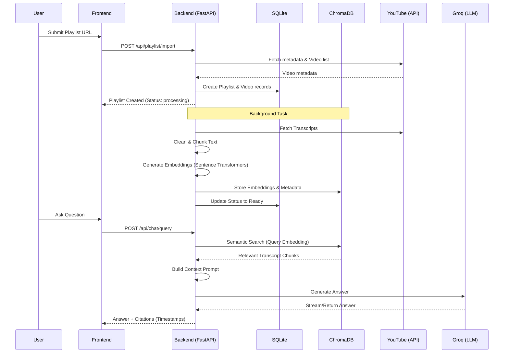

# Ytutor AI 🎓

Ytutor AI is an AI-powered learning assistant that transforms any educational YouTube playlist into an interactive, structured learning workspace. Instead of passively watching hours of content, users can chat with the videos, auto-generate study notes, create interactive flashcards, take quizzes, and export everything to beautifully formatted PDFs.

---

## 🎯 The Solution

Educational YouTube playlists are full of valuable knowledge, but they are unstructured, difficult to search, and hard to revise. Ytutor AI solves this by:
1. **Automated Ingestion**: Fetching metadata and transcripts from entire YouTube playlists.
2. **Semantic Understanding**: Cleaning, chunking, and embedding transcripts into a vector database.
3. **Generative Learning Tools**: Using Large Language Models (LLMs) and Retrieval-Augmented Generation (RAG) to provide an active learning experience.
4. **Export & Offline Study**: Generating PDFs of all your AI-created study materials.

---

## 🛠️ Tech Stack

### Frontend
* **Framework**: React.js with Vite
* **Styling**: TailwindCSS (custom glassmorphism dark theme)
* **Animations**: Framer Motion
* **Routing**: React Router DOM
* **Icons**: Lucide React

### Backend
* **Framework**: FastAPI (Python)
* **LLM Provider**: Groq API (Llama-3.3-70b-versatile)
* **Vector Database**: ChromaDB (Local embedded mode)
* **Relational Database**: SQLite with async SQLAlchemy (`aiosqlite`)
* **Embeddings**: `sentence-transformers` (`all-MiniLM-L6-v2`)
* **Utilities**: `youtube-transcript-api`, `yt-dlp` (metadata), `reportlab` (PDF generation)

---

## 🧠 Architecture

### High-Level Architecture
The application follows a decoupled client-server architecture:
* **React SPA (Frontend)**: Handles all user interactions, state management, and renders the interactive study panels (Chat, Notes, Flashcards, Quizzes).
* **FastAPI (Backend)**: Exposes RESTful endpoints. It manages asynchronous ingestion pipelines, database interactions, vector search operations, and LLM orchestration.

### Low-Level Architecture & Modules
* **Ingestion Pipeline**: 
  * `youtube.py`: Extracts playlist and video metadata.
  * `transcript.py`: Fetches and cleans YouTube subtitles, removing noise (e.g., `[Music]`).
  * `chunker.py`: Splits transcripts into token-aware overlapping chunks while preserving timestamp boundaries.
  * `vector_store.py`: Interfaces with ChromaDB. Each playlist gets its own isolated collection (`playlist_{id}`).
* **Database Layer**: Async SQLAlchemy ORM managing `Playlists`, `Videos`, `Notes`, `Flashcards`, and `Quizzes` tables.
* **RAG Engine**:
  * `retriever.py`: Performs semantic similarity search against ChromaDB using the user's query.
  * `prompt_builder.py`: Constructs system prompts, injecting retrieved transcript chunks as context.
  * `groq_client.py`: Handles communication with the Groq inference API.
* **Content Generators**: Dedicated modules that force the LLM to output structured JSON data for Flashcards and Quizzes, ensuring predictable frontend rendering.

---

## 💡 Tech Stack Decisions

1. **FastAPI over Django/Flask**: Chosen for its native asynchronous support, which is critical for non-blocking I/O operations like fetching dozens of transcripts, calling external LLMs, and writing to vector databases.
2. **SQLite + aiosqlite**: An embedded relational database allows for a zero-config setup for the MVP, while SQLAlchemy ensures we can easily migrate to PostgreSQL later.
3. **ChromaDB**: Chosen as the vector store because it runs locally within the Python process, avoiding the need to provision cloud vector databases or separate Docker containers for the MVP.
4. **Groq API**: Used for LLM inference due to its incredibly low latency (LPU hardware), which provides a snappy, conversational chat experience.
5. **TailwindCSS**: Allowed for rapid development of a premium, custom UI (gradients, glassmorphism) without writing thousands of lines of custom CSS.

---

## 🔄 Workflow Diagram



---

## 🚀 Running Instructions

### Prerequisites
* Python 3.10+
* Node.js 18+
* A [Groq API Key](https://console.groq.com/keys)

### 1. Backend Setup
Navigate to the backend directory:
```bash
cd backend
```

Install Python dependencies:
```bash
pip install -r requirements.txt
```

Set up your environment variables. Open the `.env` file and add your Groq API key:
```env
GROQ_API_KEY=your_groq_api_key_here
```

Start the FastAPI server:
```bash
uvicorn api.main:app --reload --port 8000
```
*Note: The first time you start the server, it will download the embedding model (~90MB).*

### 2. Frontend Setup
Open a new terminal and navigate to the frontend directory:
```bash
cd frontend
```

Install NPM dependencies:
```bash
npm install
```

Start the Vite development server:
```bash
npm run dev
```

### 3. Usage
1. Open your browser and go to `http://localhost:5173`.
2. Click **Get Started** and use the **Import Playlist** button.
3. Paste a YouTube playlist URL (e.g., a crash course or lecture series).
4. Wait for the background ingestion to complete.
5. Open the workspace and start generating notes, flashcards, or chatting with the content!
