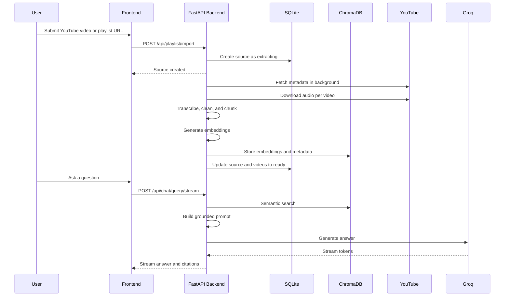

# Ytutor AI

Ytutor AI is an AI-powered learning assistant that transforms educational YouTube videos and playlists into interactive, structured learning workspaces. Instead of passively watching hours of content, users can chat with videos, auto-generate study notes, create flashcards, take quizzes, and export study material to PDF.

---

## The Solution

Educational YouTube videos and playlists are full of valuable knowledge, but they are unstructured, difficult to search, and hard to revise. Ytutor AI solves this by:

1. **Automated Ingestion**: Fetching metadata from standalone videos or full playlists.
2. **Local Transcription**: Downloading audio and transcribing it with Whisper.
3. **Semantic Understanding**: Cleaning, chunking, and embedding transcripts into a vector database.
4. **Generative Learning Tools**: Using LLMs and retrieval-augmented generation (RAG) for chat, notes, flashcards, and quizzes.
5. **Export and Offline Study**: Generating PDFs from AI-created study materials.

---

## Tech Stack

### Frontend

* **Framework**: React with Vite
* **Styling**: TailwindCSS
* **Animations**: Framer Motion
* **Routing**: React Router DOM
* **Icons**: Lucide React

### Backend

* **Framework**: FastAPI
* **LLM Provider**: Groq API
* **Vector Database**: ChromaDB in local embedded mode
* **Relational Database**: SQLite with async SQLAlchemy (`aiosqlite`)
* **Embeddings**: `sentence-transformers` (`all-MiniLM-L6-v2`)
* **Transcription**: Local Whisper via `openai-whisper`
* **YouTube Utilities**: `yt-dlp`
* **PDF Generation**: `reportlab`

---

## Architecture

The application follows a decoupled client-server architecture:

* **React SPA**: Handles user interactions, auth state, source dashboards, and the workspace panels for chat, notes, flashcards, quizzes, and exports.
* **FastAPI backend**: Exposes REST endpoints, manages async ingestion jobs, persists relational data, stores/retrieves vector embeddings, and orchestrates LLM calls.

Core backend modules:

* `ingestion/youtube.py`: Extracts metadata for playlists and standalone videos.
* `ingestion/audio_downloader.py`: Downloads YouTube audio through `yt-dlp`.
* `ingestion/transcript.py`: Runs Whisper transcription and cleans transcript segments.
* `ingestion/chunker.py`: Splits transcripts while preserving approximate timestamp mapping.
* `ingestion/vector_store.py`: Stores transcript chunks in ChromaDB collections scoped by imported source.
* `api/services/retriever.py`: Performs semantic retrieval for chat.
* `api/services/prompt_builder.py`: Builds prompts for chat and content generation.
* `api/services/groq_client.py`: Calls Groq with multi-key failover.
* `generators/`: Produces notes, flashcards, quizzes, and PDFs.

---

## Workflow



---

## Running Instructions

### Prerequisites

* Python 3.10+
* Node.js 18+
* FFmpeg on PATH
* A [Groq API key](https://console.groq.com/keys)

### Backend Setup

```bash
cd backend
pip install -r requirements.txt
```

Create a `.env` file with at least:

```env
GROQ_API_KEY=your_groq_api_key_here
JWT_SECRET_KEY=replace-this-with-a-secure-secret
APP_ENV=development
ALLOW_DEV_RESET_OTP=false
```

For production password reset email delivery, configure:

```env
SMTP_HOST=smtp.example.com
SMTP_PORT=587
SMTP_USERNAME=your_smtp_username
SMTP_PASSWORD=your_smtp_password
SMTP_FROM=no-reply@example.com
SMTP_USE_TLS=true
```

Start the API server:

```bash
uvicorn api.main:app --reload --port 8000
```

The first startup may download the embedding model and Whisper model.

### Frontend Setup

```bash
cd frontend
npm install
npm run dev
```

The frontend expects the backend at `http://localhost:8000` by default. Set `VITE_API_URL` in `frontend/.env` to override it.

### Usage

1. Open `http://localhost:5173`.
2. Create an account or log in.
3. Import a YouTube video or playlist.
4. Wait for background ingestion to complete.
5. Open the workspace to chat, generate notes, create flashcards, take quizzes, or export a PDF.
